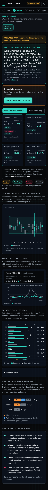
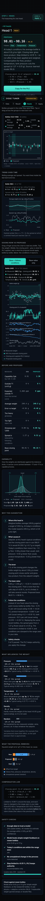
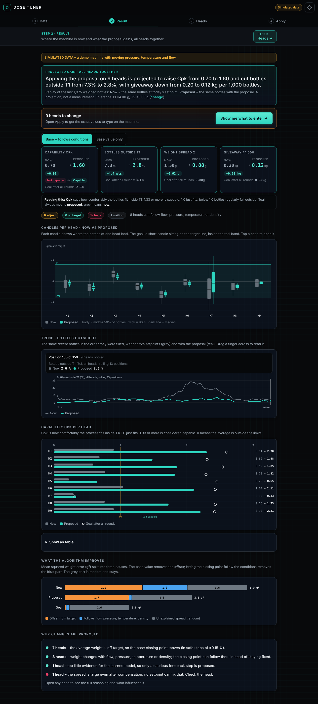

<div align="center">

# 💧 DoseTuner

**Self-calibrating dosing setpoints for multi-head filling machines.**
Drop in your PLC history. Get a safe, explained correction for every head. Runs entirely in your browser or on your phone.

[](https://github.com/Konkowski/DoseTuner/actions/workflows/ci.yml)
[](LICENSE)
[](CONTRIBUTING.md)


[**Open the app**](https://konkowski.github.io/DoseTuner/) · [Quick start](#quick-start) · [Data format](docs/DATA-FORMAT.md) · [How it works](docs/ALGORITHM.md) · [Contribute](CONTRIBUTING.md)

 &nbsp; 

</div>

---

## What it is

On a pressurised-tank filling machine with N dosing heads, every head drifts differently: flow, pressure, product temperature and density all change the weight that ends up in the bottle. Operators correct this by hand, and every correction is a guess.

**DoseTuner reads the history your PLC already records** (one row per bottle: closing point, flow, density, temperature, pressure, checkweigher weight, tolerances) and answers three questions for each head:

1. **Where am I now?** mean, spread, Cp / Cpk, expected ppm outside T1/T2, giveaway.
2. **What should I change?** a small, bounded correction to the *closing point*, expressed as a **percentage of the setpoint** (e.g. "close at 99.30 %"), never as a time.
3. **Why, and what will I gain?** a plain-language explanation of what drives the decision, and a replay of your own last bottles showing *now vs. proposed*.

It never talks to the machine. **You type the proposed values on the HMI; the PLC keeps full authority.**

## Features

| | |
|---|---|
| 📱 **Phone-only** | One HTML file. No server, no cloud, no account. Your data never leaves the device. |
| 🧠 **Self-calibrating** | Ridge + Lasso + recursive least squares on top of a physics prior. Learns per head. |
| 🛡️ **Safety layer** | Small bounded steps, data-sufficiency check (PAC-style), drift detection, automatic fallback to plain feedback when data is thin. |
| 📈 **Closing point in % of setpoint** | Follows flow, pressure, temperature and density live. No time units. |
| 🔍 **Interpretable** | Every suggestion lists the factors behind it, with sign and size. |
| 📊 **Capability view** | Cp, Cpk, ppm, giveaway, candlestick and line charts, draggable tolerance histogram. |
| 🔌 **Offline PWA** | Install to the home screen; works without network once installed. |
| 🧪 **Tested** | 57 numerical checks (simulated plant) and a UI test at phone and desktop widths. |

<p align="center"></p>

## Quick start

### 1. Use it (no install)

Open **<https://konkowski.github.io/DoseTuner/>** on your phone or computer.
Tap **Try the demo** to see it work on simulated data in a few seconds.

### 2. Install it on your phone

| Android (Chrome) | iPhone (Safari) |
|---|---|
| Open the link → ⋮ menu → **Install app** / **Add to Home screen** | Open the link → Share → **Add to Home Screen** |

After the first load the app works **offline**. Details in [docs/INSTALL.md](docs/INSTALL.md).

### 3. Use it on your own machine data

1. **Export** the per-bottle history from your PLC / HMI as CSV (see [docs/DATA-FORMAT.md](docs/DATA-FORMAT.md); a ready example is in [`examples/`](examples)).
2. **Open** DoseTuner → **Load data** → pick the file. Columns are matched automatically; confirm or fix the mapping.
3. **Read the verdict.** Heads that need a change are listed first, with *now → proposed* and the expected gain.
4. **Enter** the proposed closing points on the machine. Re-export after a few hundred bottles and repeat. The base moves in small steps, so expect several rounds.

> Rule of thumb: ≥ 200 bottles per head gives a confident answer; with less data DoseTuner says so and falls back to cautious feedback.

## How it works (one minute)

```
 CSV history ─► clean + map ─► physics prior ─► Lasso picks drivers ─► Ridge / RLS fit
                                                       │
        ┌──────────────────────────────────────────────┘
        ▼
  closing point (% of setpoint) = base + live law(flow, pressure, temperature, density)
        │
        ▼
  safety layer: bounded step · data sufficiency · drift check · feedback fallback
        │
        ▼
  now-vs-proposed replay of your last 150 bottles ─► Cp/Cpk/ppm/giveaway + explanation
```

Full description, equations and assumptions: [docs/ALGORITHM.md](docs/ALGORITHM.md).

## Honest limits

- Validated on a **simulated plant** (unit tests) and a UI test. It has **not** been validated on a real machine. Treat early suggestions as proposals and check the first rounds closely.
- The live law uses flow and pressure of the *same fill*; the PLC must log live or previous-fill values.
- Flow and pressure are often collinear, so individual coefficients can be ambiguous. The prediction is reliable; the attribution is approximate.
- Assumes the valve closes as a fraction of the commanded dose. If your machine closes on integrated weight or volume, the flow effect will be smaller.
- It recommends; it does not control. Final responsibility stays with the operator and the PLC.

Live OPC UA / EtherNet/IP are not possible from a browser (no raw TCP). See [docs/PLC-INTEGRATION.md](docs/PLC-INTEGRATION.md) for the supported route (CSV) and the roadmap (MQTT over WebSocket, gateway).

## Repository layout

```
src/            core.js (algorithm + simulator) · app.html (UI) · icon.svg
scripts/        build.js (single file + PWA) · serve.js (local static server)
test/           test.js (numerics) · ui.test.js (phone/desktop) · pwa.test.js (offline)
examples/       sample PLC histories (% and ms formats)
docs/           INSTALL · DATA-FORMAT · ALGORITHM · PLC-INTEGRATION · screenshots
.github/        CI, Pages deploy, issue and PR templates
dist/           build output (generated)
```

## Develop

Requires Node ≥ 18. The app itself has **no runtime dependencies**.

```bash
git clone https://github.com/Konkowski/DoseTuner.git
cd DoseTuner
npm run build        # writes dist/index.html and dist/pwa/
npm test             # 57 numerical checks (~1 min)
npm run serve        # http://localhost:8765  (PWA, offline test)
# UI tests need Chrome and puppeteer-core:  npm i && npm run test:ui
```

## Make it yours, and send it back

DoseTuner is MIT licensed: **fork it, change it, ship your own version.**
If your change is useful to others, open a pull request. The maintainer reviews, discusses and merges approved improvements, and they flow into the public app.

- Fork → branch → change → `npm test` → pull request. Full guide: [CONTRIBUTING.md](CONTRIBUTING.md)
- Ideas and questions: [Discussions](https://github.com/Konkowski/DoseTuner/discussions) · bugs and requests: [Issues](https://github.com/Konkowski/DoseTuner/issues/new/choose)
- Good first contributions: new CSV column aliases, translations, real-machine validation reports, new charts.

## Roadmap

- [ ] Real-machine validation reports (anonymised) and tuning of defaults
- [ ] MQTT-over-WebSocket live source (optional)
- [ ] Export of a one-page PDF report
- [ ] Translations (PT, IT, ES, DE)

## License

[MIT](LICENSE) © 2026 Konkowski. Provided as is, without warranty. Use on production equipment is at your own risk.
